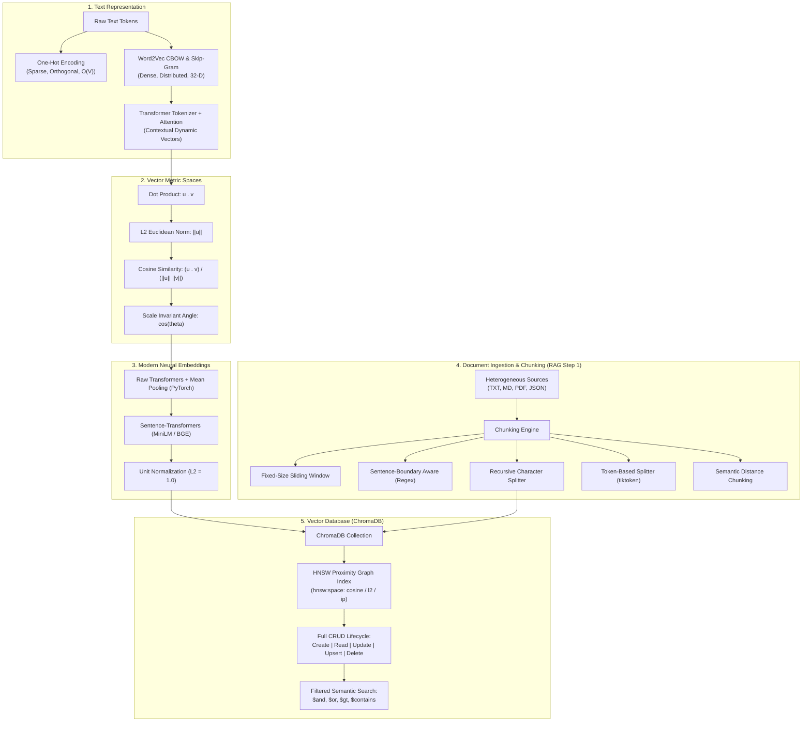

# Generative AI & Retrieval Architecture Practice Lab

[](https://www.python.org/)
[](https://jupyter.org/)
[](https://www.trychroma.com/)
[](https://huggingface.co/)
[](https://python.langchain.com/)
[](LICENSE)

A comprehensive, production-grade hands-on laboratory covering the fundamental building blocks of **Generative AI**, **Dense Vector Representations**, **Metric Space Geometry**, **Vector Database Engineering (ChromaDB)**, and **Document Chunking Pipelines for Retrieval-Augmented Generation (RAG)**.

Each module features deep mathematical foundations, from-scratch Python implementations, optimized vectorized benchmarks, real-world domain datasets, and solved practice exercises.

---

## 🗺️ Architectural Roadmap



---

## 📚 Curriculum & Notebook Breakdown

| Notebook | Topic | Key Focus & Techniques | Domain / Context |
|---|---|---|---|
| **[01_Word_Embeddings.ipynb](01_Word_Embeddings.ipynb)** | Sparse vs. Dense Embeddings | One-Hot Encoding from scratch, orthogonality proof, Word2Vec CBOW vs. Skip-Gram, vector arithmetic, 2D PCA & t-SNE | Cloud Computing & Systems Engineering |
| **[02_Cosine_Similarity_Mathematically.ipynb](02_Cosine_Similarity_Mathematically.ipynb)** | Vector Metric Mathematics | Pure Python manual loops, Cauchy-Schwarz theorem, vectorized NumPy batch matrix operations, scale invariance visualization, metric comparison | Tech Candidate Skill Profile Matching |
| **[03_HuggingFace_Embeddings.ipynb](03_HuggingFace_Embeddings.ipynb)** | Modern Transformer Embeddings | Raw PyTorch Mean-Pooling pipeline, `sentence-transformers`, pairwise heatmaps, latency benchmarking, automated incident triage engine | Enterprise Cloud & DevOps Incident Triage |
| **[04_Intro_to_Vector_Databases_ChromaDB.ipynb](04_Intro_to_Vector_Databases_ChromaDB.ipynb)** | ChromaDB Architecture | In-memory vs. Persistent storage, HNSW distance spaces (`cosine`, `l2`, `ip`), rich schema metadata, compound filtering (`$and`, `$gt`) | Cloud Architecture Knowledge Base |
| **[05_CRUD_Operations_ChromaDB.ipynb](05_CRUD_Operations_ChromaDB.ipynb)** | Production Vector CRUD | Batch ingestion with SHA-256 deduplication, pagination, atomic `upsert`, targeted deletes, `SafePaperRepository` OOP pattern | AI Research & ArXiv Paper Archive |
| **[06_RAG_Step1_Document_Loading_and_Chunking.ipynb](06_RAG_Step1_Document_Loading_and_Chunking.ipynb)** | RAG Ingestion & Chunking | TXT, MD, PDF, JSON loaders; 6 chunking algorithms (Fixed, Sentence, Recursive, Token, Semantic); distribution histograms | Enterprise AI Governance & Safety Manual |

---

## 🔬 Detailed Module Summaries

### 01. Word Embeddings: One-Hot Encoding vs. Word2Vec
- **The Core Problem:** Machines require continuous numeric approximations of discrete linguistic symbols.
- **One-Hot Failure:** Mathematical demonstration showing that all distinct word vectors are orthogonal ($S_C = 0.0$), failing to capture synonymy or semantic hierarchy while scaling quadratically with vocabulary size.
- **Word2Vec Architectures:** 
  - **CBOW (Continuous Bag of Words):** Fast prediction of center words from surrounding context.
  - **Skip-Gram:** Robust prediction of context words from center words, ideal for domain-specific terminology.
- **Vector Algebra:** Discovering latent semantic relations ($\vec{v}_{\text{kubernetes}} - \vec{v}_{\text{docker}} + \vec{v}_{\text{compiler}} \approx \dots$) and automated outlier detection via `.doesnt_match()`.

### 02. Cosine Similarity Calculated Mathematically
- **Manual Mathematics:** Step-by-step pure Python implementation of the dot product ($\mathbf{u} \cdot \mathbf{v} = \sum u_i v_i$), Euclidean magnitude ($\|\mathbf{u}\|_2 = \sqrt{\sum u_i^2}$), and angular separation ($\theta = \arccos(S_C)$).
- **Scale Invariance Proof:** Visual and mathematical demonstration showing why scaling a vector by $10\times$ leaves Cosine Similarity at $1.0$, while Euclidean distance explodes.
- **Vectorized NumPy Engine:** Batch matrix scoring function ($S = \frac{X Y^T}{\|X\| \|Y\|}$) achieving up to $150\times$ speedup over interpreted Python loops.
- **Metric Taxonomy:** Comparing Cosine Similarity, Cosine Distance, Euclidean ($L_2$), Manhattan ($L_1$), and Dot Product across edge cases (identical, scaled, orthogonal, opposite).

### 03. Hugging Face Dense Embeddings
- **Contextual vs. Static:** Overcoming Word2Vec's polysemy limit using self-attention mechanisms.
- **Under the Hood (PyTorch):** Implementing manual **Mean-Pooling** from scratch over raw token hidden states from `AutoModel`, explicitly masking padding tokens.
- **Model Benchmarking:** Measuring throughput (texts/sec), memory footprint, and representation dimensionality between lightweight and deeper transformer backbones.
- **Incident Triage Search Engine:** Natural language routing system mapping ambiguous operational symptoms to exact runbooks using cosine similarity thresholds.

### 04. Introduction to Vector Databases & ChromaDB
- **Vector DB Architecture:** Why relational B-Trees and inverted indexes fail for semantic retrieval; how Hierarchical Navigable Small World (HNSW) graphs enable sub-millisecond Approximate Nearest Neighbor (ANN) search.
- **Client Topology:** Ephemeral in-memory sessions vs. disk-backed `PersistentClient` storage.
- **HNSW Metric Spaces:** Configuring distance metrics (`cosine`, `l2`, `ip`) and translating raw distances into intuitive match confidence percentages.
- **Complex Query Filtering:** Combining high-dimensional vector search with MongoDB-style structured metadata filters (`$and`, `$gte`, `$in`, `$contains`).

### 05. Full CRUD Operations in ChromaDB
- **The Vector Lifecycle:** Analyzing the computational mechanics of inserting, mutating, and pruning dense vector graphs.
- **CREATE:** Deterministic content-hashing (SHA-256) to ensure idempotent deduplication.
- **READ:** Exact ID retrieval, non-vector attribute filtering, pagination with `limit` and `offset`, and multi-query batch searching.
- **UPDATE vs. UPSERT:** When to use targeted updates versus atomic idempotent upserts in production ETL pipelines.
- **DELETE & PRUNING:** Purging vectors by ID lists, conditional attribute filters, and soft-delete patterns (`is_deleted = True`).
- **Production Repository Pattern:** Object-oriented `SafePaperRepository` class with validation, typed signatures, and structured error handling.

### 06. RAG Step 1: Document Loading & Advanced Chunking
- **The Chunking Dilemma:** Balancing context fragmentation (under-chunking) against context dilution (over-chunking).
- **Multi-Format Ingestion:** Parsing `.txt`, `.md`, `.pdf` (via `pypdf`), and structured `.json` data.
- **6 Chunking Strategies Evaluated:**
  1. *Fixed-Character Sliding Window:* Custom baseline revealing boundary cuts.
  2. *Sentence-Aware Regex:* Preserving syntactic sentences while safeguarding technical abbreviations (`e.g.`, `i.e.`, `vs.`).
  3. *CharacterTextSplitter:* Splitting on paragraph delimiters.
  4. *RecursiveCharacterTextSplitter:* Industry-standard hierarchical splitting maintaining syntactic integrity.
  5. *Token-Based Splitter (`tiktoken`):* Strict token budgeting avoiding LLM context truncation.
  6. *Semantic Chunking:* Dynamic split points determined by embedding distance jumps between adjacent sentences.
- **Visual Analytics:** Matplotlib histograms and boxplots evaluating chunk count distributions and sentence-boundary integrity scores.
- **Production Pipeline Module:** Reusable `RAGIngestionPipeline` attaching provenance metadata (`chunk_id`, `source`, `token_count`, `char_length`).

---

## 🚀 Quickstart & Setup

### Option 1: Local Environment

1. **Clone the repository:**
   ```bash
   git clone https://github.com/<your-username>/gen-ai-practice-lab.git
   cd gen-ai-practice-lab
   ```

2. **Create and activate a virtual environment:**
   ```bash
   # Windows (PowerShell)
   python -m venv venv
   .\venv\Scripts\Activate.ps1

   # Linux / macOS
   python3 -m venv venv
   source venv/bin/activate
   ```

3. **Install dependencies:**
   ```bash
   pip install -r requirements.txt
   ```

4. **Launch JupyterLab:**
   ```bash
   jupyter lab
   ```

### Option 2: Google Colab
All notebooks include self-contained `!pip install` cells at the top and require no local GPU or paid API keys. Simply upload any `.ipynb` file to [Google Colab](https://colab.research.google.com/) and run all cells sequentially.

---

## 📁 Repository Structure

```
gen-ai-practice-lab/
├── .gitignore
├── requirements.txt
├── README.md
├── LICENSE
├── 01_Word_Embeddings.ipynb
├── 02_Cosine_Similarity_Mathematically.ipynb
├── 03_HuggingFace_Embeddings.ipynb
├── 04_Intro_to_Vector_Databases_ChromaDB.ipynb
├── 05_CRUD_Operations_ChromaDB.ipynb
├── 06_RAG_Step1_Document_Loading_and_Chunking.ipynb
└── data/
    ├── sample_governance_handbook.txt
    ├── sample_tech_article.md
    └── sample_knowledge_base.json
```

---

## 🛠️ Tech Stack & Dependencies

- **Languages & Frameworks:** Python 3.9+, Jupyter Notebook
- **Mathematics & Data:** `numpy`, `pandas`, `scipy`, `scikit-learn`
- **Visualization:** `matplotlib`, `seaborn`
- **Vector Representations:** `gensim`, `sentence-transformers`, `transformers`, `torch`
- **Vector Database:** `chromadb`
- **RAG & Chunking:** `langchain-text-splitters`, `tiktoken`, `pypdf`, `fpdf2`

---

## 📄 License
This repository is released under the [MIT License](LICENSE). You are free to use, adapt, and build upon these materials for study, teaching, and commercial applications.

